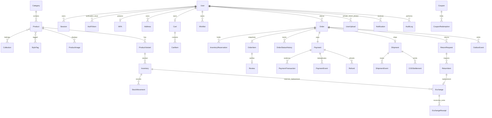

# Kiến trúc MILOSHOPHAND

Một cửa hàng, một kho MAIN ban đầu. Next.js storefront/Admin gọi NestJS /api/v1 cùng origin qua reverse proxy. Prisma/PostgreSQL là nguồn sự thật. Redis phục vụ cache/rate limit/BullMQ; worker xử lý transactional outbox, expiry và đối soát. Module auth, catalog, commerce, providers, admin; không có đa nhà bán hàng.

VND nguyên, thời điểm UTC, UI Asia/Ho_Chi_Minh. Một coupon/đơn, không cộng dồn. Thuế mặc định 0. Phí phát triển 30.000đ, miễn từ 699.000đ; production dùng GHN. QR mock là dữ liệu kiểm thử, không chuyển tiền. Admin tạo qua CLI, không có mật khẩu mặc định; bắt buộc TOTP. Season/climate/campaign là thuộc tính Collection cấu hình được.



AuthToken gộp verification/reset bằng purpose; token và recovery codes lưu hash. Snapshot đơn giữ tên, SKU, thuộc tính, đơn giá, giá vốn, phân bổ giảm và địa chỉ. Lưu location chỉ cho giao hàng, marketing opt-in riêng.

| Quyền | Khách | USER | ADMIN + MFA |
|---|---|---|---|
| Catalog, chính sách | đọc | đọc | đọc |
| Cart | local | của mình, merge | của mình |
| Checkout | không | email verified | email verified |
| Hồ sơ/địa chỉ/phiên/đơn | không | chỉ của mình | bản thân + tra cứu quản trị |
| Review | không | dòng đã giao, một lần | kiểm duyệt có lý do |
| Catalog/kho/coupon/nội dung | không | không | CRUD + audit |
| COD/refund | không | đọc của mình | reauth + evidence + audit |
| Webhook | xác thực provider riêng | như khách | như khách |

| Chuyển trạng thái | Actor/điều kiện | Tác động |
|---|---|---|
| checkout → PENDING_PAYMENT | verified user, QR | reserve nguyên tử; deadline đồng bộ link |
| checkout → PENDING_CONFIRMATION | verified user, COD dưới hạn | reserve; UNPAID; hạn xác nhận |
| PENDING_PAYMENT → PENDING_CONFIRMATION | provider evidence, đúng tiền/VND/còn hạn | PAID; reference unique; notification |
| PENDING_CONFIRMATION → CONFIRMED → PACKING → READY_TO_SHIP | admin MFA | history và outbox |
| READY_TO_SHIP → SHIPPED | admin/carrier; QR PAID; vận đơn có thật | giảm onHand và reserved đúng một lần |
| SHIPPED → DELIVERED → COMPLETED | carrier đã đối soát/admin có chứng cứ | COD collected tách remitted |
| trước SHIPPED → CANCELLED | owner ở giai đoạn cho phép/admin/expiry đã reconcile | release ACTIVE đúng một lần; paid mở refund |
| SHIPPED trở đi → ReturnRequest | user/admin | hàng chưa QC không vào kho |
| expired/cancelled + tiền đến | provider hợp lệ | payment EXCEPTION; không khôi phục đơn |
| delivery failed → returning → returned | carrier đã đối soát | không tự nhập kho |

Sự kiện trùng trả kết quả hiện hữu. Sai thứ tự không ghi lùi; lưu event và bỏ qua. Shipment callback chỉ là tín hiệu đối soát API GHN, không tin payload công khai. Payment không có endpoint sửa PAID thủ công. Refund hoàn thành chỉ khi có bằng chứng, tổng không vượt thực nhận.

```
apps/web       storefront, account, admin, maps, lazy 3D
apps/api       Nest modules, security, providers, domain services
apps/worker    outbox → BullMQ, retries, expiry, notifications
packages/shared  validation, money, state machine
prisma         schema, migration, seed
infra          Docker, Nginx, persistent volumes
scripts        setup, bootstrap admin, local PostgreSQL
tests          unit, PostgreSQL integration, Playwright
docs           architecture, API, operations, verification
```
